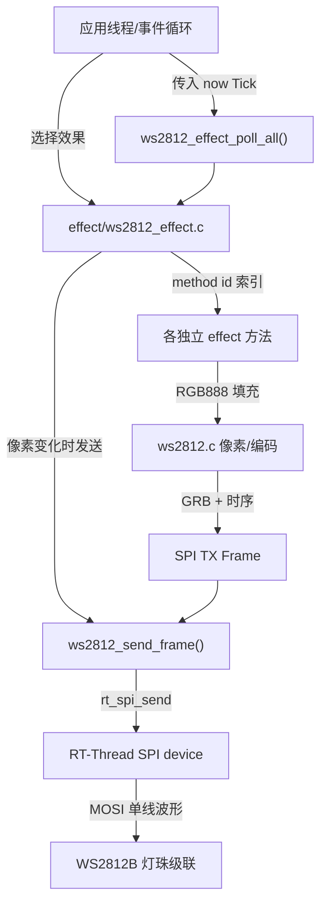
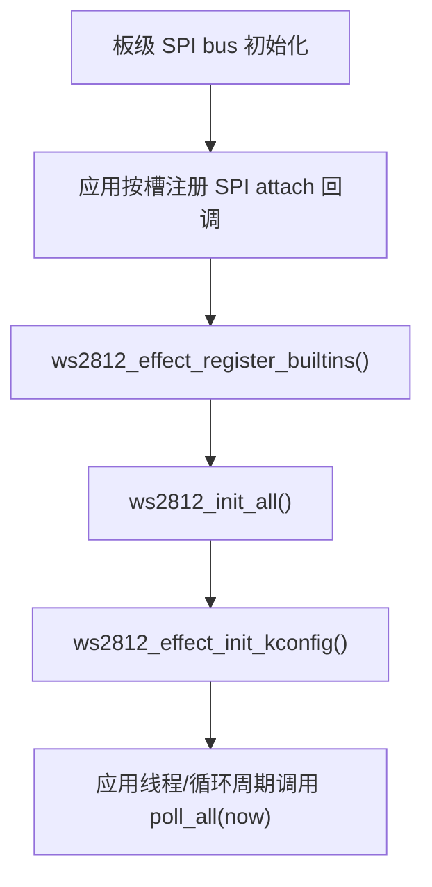

# WS2812B 软件包架构与重构实现说明

本文以当前 `packages/ws2812b-latest/` 快照为准。软件包负责将 RGB888 像素转换为 WS2812B 单线高低电平序列，并通过 RT-Thread SPI 接口发送；不负责创建业务线程、CAN/BMS 协议或板级 GPIO 初始化。

## 模块和数据路径



| 组件 | 主要入口 | 所有权与依赖 |
|---|---|---|
| `ws2812.c/.h` | `ws2812_create_with_config()`、`ws2812_init_all()`、`ws2812_set_pixel()`、`ws2812_send_frame()` | 设备注册、内存池、时序编码和 SPI 发送 |
| `ws2812_timing.c` | `ws2812_timing_select()`、`ws2812_timing_validate()` | 只在 TABLE/SEARCH/扩展时序校验配置下编入 |
| `gamma/` | `ws2812_set_gamma()`、`ws2812_set_gamma_custom()` | 固定 Gamma 表存 Flash；计算模式需要 libm，按设备产生表 |
| `effect/ws2812_effect.c` | 注册、start、stop、poll、`ws2812_effect_start_sequence()` | `methods[id]` 直接定位方法；每设备一个当前效果 |
| `effect/ws2812_effect_*.c` | 各自的 start/update 回调 | 只生成像素，不自行发送 SPI |
| `ws2812b_msh.c` | `ws2812b` 命令（效果、亮度、Gamma、状态） | 可选调试入口，不负责创建线程和初始化设备 |
| `Kconfig`、`SConscript` | menuconfig、编译对象选择 | 选择预留容量、算法、默认效果和可编译方法 |

## 初始化与生命周期



1. `ws2812_set_kconfig_attach(slot, callback, user_data)` 将 SPI attach 函数保存在指定设备槽中。如果 BSP 已注册同名设备，可不需要回调。回调内部必须使用真实 BSP 的 SPI attach 参数和 CS/引脚处理规则。
2. `ws2812_effect_register_builtins()` 注册已按 Kconfig 编译的灯效方法，已启用内置 ID 连续压缩至 0～N-1（N 为已编译方法数）。仅在启动阶段调用一次；软件包不维护“已初始化”状态位。
3. `ws2812_init_all()` 按已启用的 Kconfig 槽创建设备，设置 SPI 参数，准备编码缓存，并保留创建顺序注册表和命名槽映射。创建阶段失败返回错误，不能继续默认效果初始化。
4. `ws2812_effect_init_kconfig()` 为每个有效设备选择 `WS2812B_DEVn_INITIAL_*` 默认效果，**不执行 SPI 发送**。
5. 由应用自行定时调用 `ws2812_effect_poll_all(rt_tick_get())`。效果执行到变化时修改像素，随后 `ws2812_send_frame()` 一次输出完整 SPI 帧。

设备和方法**仅初始化期注册，运行期不支持新增、销毁或重复初始化**。灯效切换不引入第二级覆盖状态；需要恢复原效果时，应用重新调用默认效果或自己的方法。共享像素缓冲区和效果配置由同一轮询上下文串行操作；SPI bus 层的互斥不能取代设备缓冲区互斥。

## 编码与发送

RGB888 采用 `0x00RRGGBB`，传输顺序为 G、R、B，每通道高位先发送。`ws2812_adjust_component()` 首先应用全局亮度，再按设备选择的 Gamma 表修正；`ws2812_encode_pixel()` 使用快速四位查表或通用逐位编码得到 MOSI 的连续高低电平位串。

快速方案为每个逻辑 4-bit 值预先准备 16 项模板。当每个 WS2812 数据位占 C 个 SPI 时钟且 C 为偶数时，每项占 `C/2` 字节，每通道的高低两个四位片段分别进行一次 `rt_memcpy`。每像素因此执行 6 次模板复制。`FAST_ONLY` 不满足支持范围时在创建阶段报错；`AUTO` 可选择通用编码器。

SPI 发送不传输 WS2812 地址、片选命令或 SPI 协议帧头。它只是利用**MOSI 的位时间**合成 WS2812 单线波形。`rt_spi_send()` 向 SPI 设备发送整帧，`SCK/CS/MISO` 并非灯珠所需的数据接口；硬件接线和 MOSI 空闲电平要在板级确认。详见 [WS2812B 单线协议和 SPI 编码原理](ws2812b-spi-theory.md)。

## 内存和时间预算

设 N 为灯珠数、C 为每个 WS2812 数据位占用的 SPI 时钟、F 为实际 SPI 时钟（Hz）、R 为 RESET 低电平（μs）：

- RGB888 原始像素：`4*N` 字节（每像素使用 `uint32_t`）。
- 编码数据：`3*N*C` 字节（每颗灯珠 24*C 比特）。
- 一段 RESET 填充：`ceil(F*R / 8000000)` 字节。
- 当前发送帧包含前后两段 RESET：`3*N*C + 2*ceil(F*R/8000000)` 字节。
- 快速模板占 `16 * WS2812_FAST_NIBBLE_MAX_BYTES` 字节/设备（设备结构体中的编译期预留值，不是动态申请）。
- `effect` 管理器还有每设备 `WS2812B_EFFECT_STATE_BYTES` 私有状态和 `WS2812B_EFFECT_MAX_STEPS` 个步骤槽，不能与原始像素/发送帧混算。

9 MHz、C=12、N=40、R=300 μs：像素 160 字节、编码数据 1440 字节、前后低电平各 338 字节，实际 TX 长度 2116 字节；单次发送的理论线速时间约为 1.881 ms，不含任务调度、CPU 编码、SPI 驱动和 DMA 停机开销。静态模式可单路手填 `WS2812B_DEVn_FRAME_BYTES`，但低于实际长度时会造成初始化失败（在启用参数检查时）。

动态模式改用 RT-Thread Heap；静态模式通过全局对象、像素池和帧池提供空间。**软件包不创建线程，也不预留线程栈**，线程容量由消费者计算。

## 方法和外部接口

`ws2812_effect_register_at(slot, method)` 注册一个自定义方法，要求 `method->id == slot`，并且该下标没有被占用。`ws2812_effect_start(dev, &config)` 仍是通用方法入口。已编译 SEQUENCE 时可直接使用：

```c
ws2812_effect_step_t steps[] = {
    {0xFF0000U, 100U},
    {0x0000FFU, 100U}
};
ws2812_effect_start_sequence(dev, steps, 2U);
/* Application-controlled polling loop: */
ws2812_effect_poll_all(rt_tick_get());
```

`ws2812_effect_start_sequence()` 只组装方法配置并复用 `ws2812_effect_start()`，方法状态会在返回前复制步骤数组；传入的时间单位**必须是 RTOS Tick**。调用方仍需在一个线程上下文串行化 start/poll；自定义方法中的 update 回调只修改像素，不能把应用业务逻辑塞进软件包。

原始软件包五个 API `ws2812_create()`、`ws2812_clear_buff()`、`ws2812_write_rgb_to_node()`、`ws2812_write_rgb_to_all()` 和 `ws2812_send()` 保持签名。新 API 用于可配置实例、Gamma 和灯效，未删除原入口。

## 配置、故障与维护入口

| 需要调整 | 修改位置 | 注意事项 |
|---|---|---|
| SPI 设备号、实际频率、灯珠数 | `Kconfig` 的设备槽配置；BSP attach | `spi_hz` 必须对应真实 SCK，而非仅软件请求值 |
| 逻辑 0/1 波形 | `Kconfig` 的 `CLOCKS_PER_BIT/T0H/T1H` | 对照**相应芯片版本**的数据手册核算四段脉宽 |
| RAM 预算 | `STATIC_MAX_CLOCKS_PER_BIT`、每路 `FRAME_BYTES` | 自动容量是按最大宽度预算；手动值需有足够长度 |
| Gamma | `gamma/`、`WS2812B_USING_GAMMA` | 默认 NONE；计算模式调用 `powf`，需 libm |
| 增减内置效果 | `effect/`、Kconfig 和 `SConscript` | 方法 ID 与数组下标一致，注册在初始化期完成 |
| SPI 发送错误 | `ws2812_send_frame()` | `rt_spi_send()` 字节数不等于期望长度时报错 |
| 波形异常/复位异常 | MOSI、SPI 设备驱动 | 检查 CS/空闲低电平、真实分频、DMA 尾时序及供电逻辑电平 |

本文描述源码及配置可推导的行为；不代表已完成 RT-Thread 3.1.4 LTS 工程构建、示波器测量或目标板验证。
