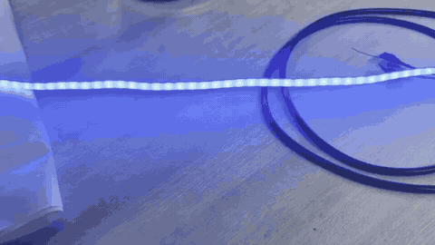
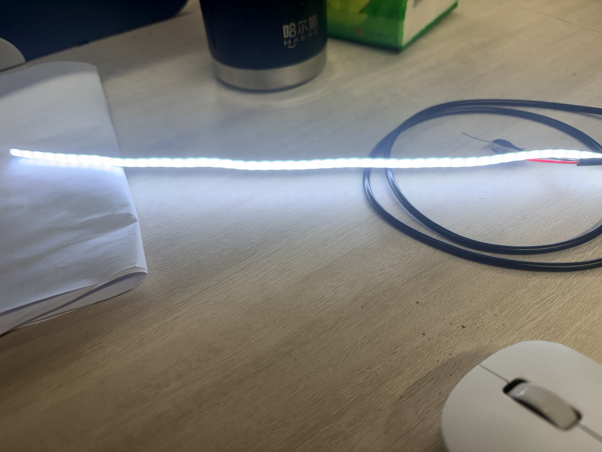
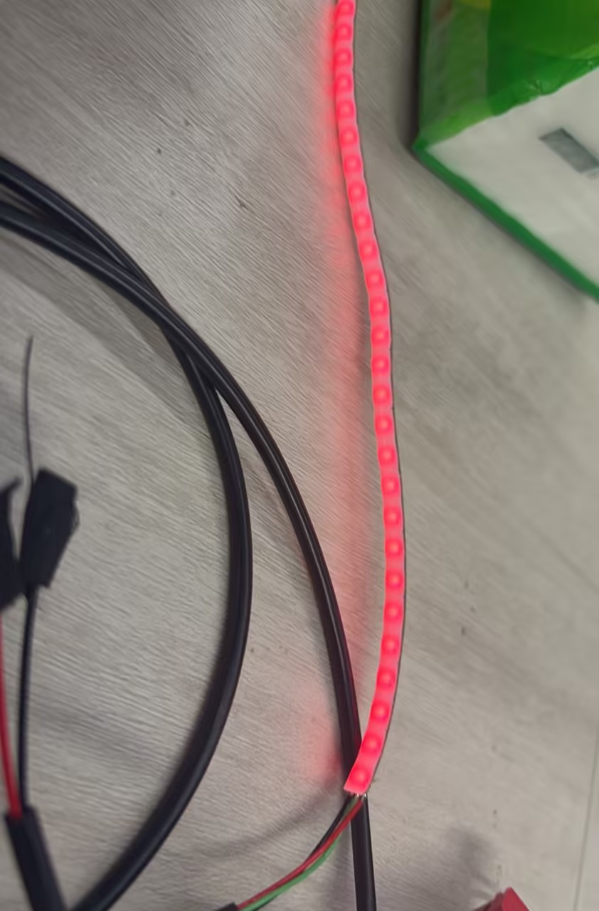
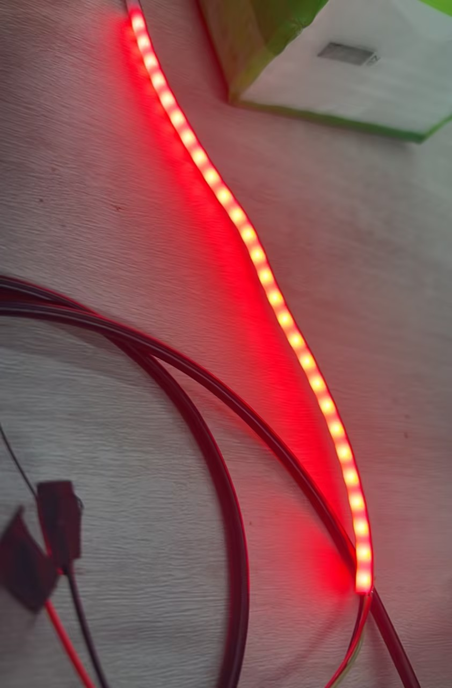

# 灯带实物效果展示

以下素材来自实际灯带拍摄，**11 段 MP4 与 3 张 JPG 均保留原始文件内容**。
灯效名称依据画面作出推测，用于检索演示素材，**不等同于有命令记录的功能验收结论**。

## 动态预览

该 GIF 由 `video(7).mp4` 缩放抽帧生成（480px、8 fps、有限颜色数），展示整条灯带颜色轮换。
可播放的 MP4 保留原帧率与时长，适合观察变换节奏与完整颜色。

## 视频索引

| 原文件 | 推测对应的灯效 | 画面观察 |
| --- | --- | --- |
| [`video(4).mp4`](#视频-04) | Chase / 逐点移动 | 短时出现的绿色局部亮点，推测为追逐灯效或局部像素点亮。 |
| [`video(5).mp4`](#视频-05) | Gradation / 空间渐变 | 同一帧内呈现蓝白与浅黄等色区，推测为沿灯带方向的空间渐变。 |
| [`video(6).mp4`](#视频-06) | Gradation / 紫蓝色带 | 局部紫色与蓝色并存，推测为空间渐变效果片段。 |
| [`video(7).mp4`](#视频-07) | Sequence / 颜色轮换 | 整条灯带依次显示蓝、绿、红等颜色，推测为颜色序列或预设颜色轮播。 |
| [`video(8).mp4`](#视频-08) | Blink / 红色闪烁 | 红色与熄灭交替，推测为闪烁效果。 |
| [`video(9).mp4`](#视频-09) | Blink / 红色闪烁 | 红色与熄灭交替的另一段录制，推测为闪烁效果。 |
| [`video(10).mp4`](#视频-10) | Gradient / 时间渐变 | 紫色、蓝色在不同时间出现，推测为整条灯带随时间渐变。 |
| [`video(11).mp4`](#视频-11) | Sequence / 多色切换 | 浅绿、蓝白及暖黄色依次切换，推测为颜色序列或预设颜色轮播。 |
| [`video(12).mp4`](#视频-12) | Sequence / 多色切换 | 青、蓝、紫等颜色切换，推测为多色序列。 |
| [`video(13).mp4`](#视频-13) | Sequence / 多色循环 | 浅黄绿、蓝色、绿色交替出现，推测为预设颜色轮播。 |
| [`video(14).mp4`](#视频-14) | Solid / 浅绿色常亮 | 短片中主要为均匀浅绿色，推测为单色常亮。 |

## 逐段视频

### 视频 04：Chase / 逐点移动（推测）

短时出现的绿色局部亮点，推测为追逐灯效或局部像素点亮。

<video controls preload="none" playsinline width="640" poster="media/posters/video-04.jpg">
  <source src="media/videos/video-04.mp4" type="video/mp4">
  当前页面不支持内嵌播放，请使用下方视频文件链接。
</video>

[播放或下载原视频 `video(4).mp4`](media/videos/video-04.mp4)

### 视频 05：Gradation / 空间渐变（推测）

同一帧内呈现蓝白与浅黄等色区，推测为沿灯带方向的空间渐变。

<video controls preload="none" playsinline width="640" poster="media/posters/video-05.jpg">
  <source src="media/videos/video-05.mp4" type="video/mp4">
  当前页面不支持内嵌播放，请使用下方视频文件链接。
</video>

[播放或下载原视频 `video(5).mp4`](media/videos/video-05.mp4)

### 视频 06：Gradation / 紫蓝色带（推测）

局部紫色与蓝色并存，推测为空间渐变效果片段。

<video controls preload="none" playsinline width="640" poster="media/posters/video-06.jpg">
  <source src="media/videos/video-06.mp4" type="video/mp4">
  当前页面不支持内嵌播放，请使用下方视频文件链接。
</video>

[播放或下载原视频 `video(6).mp4`](media/videos/video-06.mp4)

### 视频 07：Sequence / 颜色轮换（推测）

整条灯带依次显示蓝、绿、红等颜色，推测为颜色序列或预设颜色轮播。

<video controls preload="none" playsinline width="640" poster="media/posters/video-07.jpg">
  <source src="media/videos/video-07.mp4" type="video/mp4">
  当前页面不支持内嵌播放，请使用下方视频文件链接。
</video>

[播放或下载原视频 `video(7).mp4`](media/videos/video-07.mp4)

### 视频 08：Blink / 红色闪烁（推测）

红色与熄灭交替，推测为闪烁效果。

<video controls preload="none" playsinline width="640" poster="media/posters/video-08.jpg">
  <source src="media/videos/video-08.mp4" type="video/mp4">
  当前页面不支持内嵌播放，请使用下方视频文件链接。
</video>

[播放或下载原视频 `video(8).mp4`](media/videos/video-08.mp4)

### 视频 09：Blink / 红色闪烁（推测）

红色与熄灭交替的另一段录制，推测为闪烁效果。

<video controls preload="none" playsinline width="640" poster="media/posters/video-09.jpg">
  <source src="media/videos/video-09.mp4" type="video/mp4">
  当前页面不支持内嵌播放，请使用下方视频文件链接。
</video>

[播放或下载原视频 `video(9).mp4`](media/videos/video-09.mp4)

### 视频 10：Gradient / 时间渐变（推测）

紫色、蓝色在不同时间出现，推测为整条灯带随时间渐变。

<video controls preload="none" playsinline width="640" poster="media/posters/video-10.jpg">
  <source src="media/videos/video-10.mp4" type="video/mp4">
  当前页面不支持内嵌播放，请使用下方视频文件链接。
</video>

[播放或下载原视频 `video(10).mp4`](media/videos/video-10.mp4)

### 视频 11：Sequence / 多色切换（推测）

浅绿、蓝白及暖黄色依次切换，推测为颜色序列或预设颜色轮播。

<video controls preload="none" playsinline width="640" poster="media/posters/video-11.jpg">
  <source src="media/videos/video-11.mp4" type="video/mp4">
  当前页面不支持内嵌播放，请使用下方视频文件链接。
</video>

[播放或下载原视频 `video(11).mp4`](media/videos/video-11.mp4)

### 视频 12：Sequence / 多色切换（推测）

青、蓝、紫等颜色切换，推测为多色序列。

<video controls preload="none" playsinline width="640" poster="media/posters/video-12.jpg">
  <source src="media/videos/video-12.mp4" type="video/mp4">
  当前页面不支持内嵌播放，请使用下方视频文件链接。
</video>

[播放或下载原视频 `video(12).mp4`](media/videos/video-12.mp4)

### 视频 13：Sequence / 多色循环（推测）

浅黄绿、蓝色、绿色交替出现，推测为预设颜色轮播。

<video controls preload="none" playsinline width="640" poster="media/posters/video-13.jpg">
  <source src="media/videos/video-13.mp4" type="video/mp4">
  当前页面不支持内嵌播放，请使用下方视频文件链接。
</video>

[播放或下载原视频 `video(13).mp4`](media/videos/video-13.mp4)

### 视频 14：Solid / 浅绿色常亮（推测）

短片中主要为均匀浅绿色，推测为单色常亮。

<video controls preload="none" playsinline width="640" poster="media/posters/video-14.jpg">
  <source src="media/videos/video-14.mp4" type="video/mp4">
  当前页面不支持内嵌播放，请使用下方视频文件链接。
</video>

[播放或下载原视频 `video(14).mp4`](media/videos/video-14.mp4)

## 照片

### 蓝白色整条灯带

整条灯带亮起蓝白色，末端带暖黄色，适合展示多颗灯珠同时输出。

[查看原尺寸图片（来源：`b093a3fa-5f94-4d85-ad0c-abadda3ed6b1.jpg`）](media/photos/photo-white-blue.jpg)

### 红色灯带近景 A

红色灯珠阵列的竖向拍摄，便于观察单颗灯珠与灯带间距。

[查看原尺寸图片（来源：`0af32847-bd9a-47f8-950d-1a891f98bc4c.jpg`）](media/photos/photo-red-vertical-a.jpg)

### 红色灯带近景 B

另一张红色灯带竖向近景，保留作为第二个拍摄角度。

[查看原尺寸图片（来源：`b0f05d74-0b75-4627-855a-274727184db8.jpg`）](media/photos/photo-red-vertical-b.jpg)

## 素材存放与页面兼容

- `doc/media/videos/` 保留全部原始 MP4 内容，文件名由 `video(7).mp4` 等规范化为 `video-07.mp4`；只更名、不重新编码。
- `doc/media/photos/` 保留原始 JPG 内容；只更名、不重新压缩。
- `doc/media/posters/` 是从对应 MP4 提取的静态封面，改善网页加载体验。
- `doc/media/preview-color-cycle.gif` 仅用于 README/页面自动预览，**不是替代原 MP4 的完整证据**。
- GitHub Markdown 渲染器可能不显示 HTML `<video>` 播放器；每段视频都附有普通 Markdown 文件链接。MkDocs/GitHub Pages 可使用浏览器原生视频播放控件。
- 若站点使用固定 `nav` 的 `mkdocs.yml`，应将 `effects-demo.md` 加入导航；本次未修改仓库中不存在的 MkDocs 配置文件。

返回 [文档首页](index.md)。
