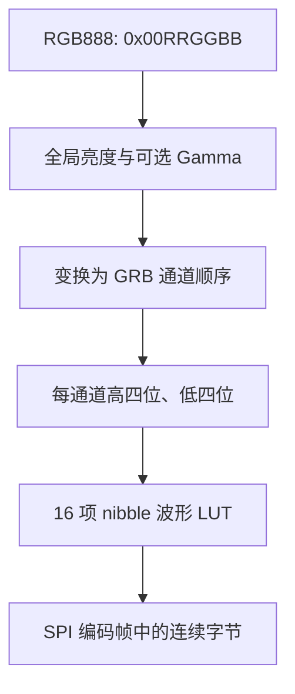

<meta name="referrer" content="no-referrer" />

# WS2812B 单线通信原理与 SPI 波形编码实现

> 摘要：从 WS2812B 单线脉宽编码、GRB 级联和 RESET 锁存出发，解释如何用 MCU SPI 的 MOSI 合成数据波形，并映射到 RT-Thread 软件包的查表编码、帧缓冲和灯效轮询实现。

[TOC]

## 1. WS2812B 在灯带系统中的位置

WS2812B 是将 RGB LED 和数字控制电路集成在同一封装中的可寻址灯珠。控制器通过**单根数据线 DIN**连续发送 RGB 颜色数据；灯珠内部读取属于自己的前 24 位数据，剩余部分经 DOUT 传递给下一级，并在足够长的低电平间隔后锁存刷新。[S1][S2]

它的输入**不是标准 SPI 帧**：灯珠既没有独立的时钟输入，也没有 SPI 片选协议。SPI 只是在 MCU 侧作为精确定时的位流发生器，真正连接 LED 数据输入的是 MOSI。本文讨论 Worldsemi 的经典 WS2812B 与 WS2812B V5 两类时序，并以当前 RT-Thread 软件包中的四位查表编码实现为例；电源/电气连接以具体 PCB 和器件版本为准。

以下资料可作为原理核对的权威入口：[经典 WS2812B 数据手册（Worldsemi，经 SparkFun 分发）](https://cdn.sparkfun.com/assets/e/6/1/f/4/WS2812B-LED-datasheet.pdf)、[WS2812B V5 数据手册（Worldsemi，经 TME 分发）](https://www.tme.eu/Document/db42ace4406f6d6cc84f1108a91ee0d5/WS2812B-B.pdf)、[RT-Thread SPI 设备使用文档](https://www.rt-thread.io/document/site/programming-manual/device/spi/spi/)。这些资料支撑具体时序和设备 API，正文不依赖它们才能读懂。


控制器按灯珠的物理级联顺序发送颜色，没有单独的目标地址。发送第 1 颗灯的颜色后，继续发送第 2 颗、第 3 颗，直到整串完成。全帧结束后保持数据线低电平达到器件所需 RESET 时长，灯珠将新颜色显示出来。[S1][S2]

## 2. 一个逻辑数据位怎样编码

WS2812B 使用单线归零式（NRZ）脉宽编码：一个逻辑数据位由**先高后低**的波形组成；逻辑 0 和逻辑 1 主要通过高电平持续时间区分。T0H、T0L、T1H、T1L 分别指两种符号对应的高/低时间，RESET 是刷新帧末尾的长低电平。[S1][S2]

不同修订的数据手册不能混用。下面直接列出两份厂商文档的参数，以便解释编码器选型：

| 信号 | 经典 WS2812B 数据手册 | WS2812B V5 数据手册 |
|---|---|---|
| T0H | 约 0.40 μs，±0.15 μs | 0.22～0.38 μs |
| T0L | 约 0.85 μs，±0.15 μs | 0.58～1.00 μs |
| T1H | 约 0.85 μs，±0.15 μs | 0.58～1.00 μs |
| T1L | 约 0.40 μs，±0.15 μs | 0.58～1.00 μs |
| RESET | 大于 50 μs | 大于 280 μs |

上述经典版数据对应 [S1] 所列版次，V5 对应 [S2]；它们不是对所有名为 WS2812B 的兼容器件的保证。尤其是 V5 的 T1L 约束与经典版不同，因此软件包的 `WS2812_VARIANT_LEGACY` 和 `WS2812_VARIANT_V5` 不应当只作为显示名称。

每颗灯珠消耗 24 个逻辑数据位，次序为 `G7..G0 → R7..R0 → B7..B0`，各通道最高位先发送。[S1][S2] 例如应用颜色 `0x00112233` 表示 R=0x11、G=0x22、B=0x33；实际数据顺序则是 G=0x22、R=0x11、B=0x33。这是 `ws2812_encode_pixel()` 先构造 `grb[]` 的原因。[S4]

## 3. SPI 如何合成 0 和 1

SPI 主机发送一个字节时，MOSI 按配置的数据位次序在每个 SCK 周期输出一个高/低状态。WS2812B 无需接收 SCK；只要 MOSI 的高低电平持续时间符合 WS2812B 的时间要求，普通 SPI 发送就能模拟单线波形。[S3][S4]

设：

- F：MCU **实际** SPI 时钟（Hz）；
- C：一个 WS2812B 逻辑位使用的 SPI 时钟数；
- H0/H1：逻辑 0/1 先输出高电平的 SPI 时钟个数。

则每位总长度为 `C/F` 秒，高低电平时间分别为：

\[
T_{0H}=H_0/F,\quad T_{0L}=(C-H_0)/F
\]
\[
T_{1H}=H_1/F,\quad T_{1L}=(C-H_1)/F
\]

举例：假设 SPI 实际为 **9 MHz**，选择 `C=12, H0=3, H1=6`，则一个逻辑位由 12 个 MOSI 采样时隙表示：

```text
WS2812 0  →  111000000000   (T0H = 0.333 us; T0L = 1.000 us)
WS2812 1  →  111111000000   (T1H = 0.667 us; T1L = 0.667 us)
```

总位时间为 `12/9MHz = 1.333 μs`。这组数值处于 [S2] 的 V5 列明范围内（T0L 位于上边界），但容差和边沿抖动仍须通过**实际 SPI 分频与示波器**确认；Kconfig 写 `9000000` 并不能证明物理 SCK 精确等于 9 MHz。不能把这组编码无条件用于经典 WS2812B，因为经典版的 T1L 典型值更短。[S1][S2][S4]

## 4. 为什么采用四位查表编码

最直接的办法是依次读取 24 个逻辑位，对每一位逐个填入 C 个 SPI 时隙。但每颗 LED 都进行三层循环会让 CPU 在高刷新率或多灯带场景下承担较大编码成本。

当前软件包的 `ws2812_prepare_fast_nibbles()` 在设备创建时生成 16 种四位组合的 SPI 模板（`0000`～`1111`）；`ws2812_encode_fast()` 则将 G、R、B 各自拆为高四位和低四位，分别用 `rt_memcpy()` 复制预计算模板。[S4]



对于 `C=12`，四个 WS2812 数据位产生 `4×12=48` 个 SPI 位，即 **6 字节**模板；16 个组合总共 **96 字节**。每个通道复制两次，所以每颗灯珠只做六次模板复制，而不是针对全部 24 个逻辑位逐一展开。模板填充仍按 `H0/H1` 决定高电平时隙数，未改变协议位序。[S4]

这种快速实现要求四位模板恰好由整数字节组成，也就是 `4*C` 能被 8 整除；C 为偶数时满足。软件包默认的 `WS2812B_ENCODER_FAST_ONLY` 不支持相应时序则在初始化时失败；可选 `WS2812B_ENCODER_AUTO` 允许逐位参考编码器兜底。**减少 CPU 循环次数不意味着减小发送帧的总字节数**，SPI 必须输出的时序仍由物理协议决定。[S4]

## 5. 为什么一帧有 RESET 前后填充

单颗灯珠的 24 个数据位，每位占 C 个 SPI 时钟，换算成字节：`24*C/8 = 3*C` 字节。因此 N 颗灯珠的纯编码数据长度是 `3*N*C` 字节。若 RESET 的目标低电平长度为 R 微秒，则一段低电平需要的发送字节数为：

\[
B_{reset}=\left\lceil\frac{F\times R}{8\times10^6}\right\rceil
\]

这里的分母 **8,000,000** 来自 8 bit/Byte 与 1,000,000 μs/s，**不能替换成 `>> 23`**，因为它不是 2 的整数次幂。当前软件包为帧首、帧尾各预留一段低电平，使连续帧开始前后都有明确的低电平时间；整个 `tx_buffer` 的结构如下：[S4]

```text
[ RESET zeros ][ N × 24-bit GRB converted to SPI bytes ][ RESET zeros ]
```

当 F=9 MHz、R=300 μs 时，`ceil(9,000,000×300/8,000,000)=338` 字节。若 N=40、C=12，纯编码为 `40×36=1440` 字节，整个发送帧长 **2116 字节**。每次整帧按 9 MHz 发送的理论线速时间约 1.881 ms；这个值不包含调用、排队、SPI DMA 启动和尾时序等开销。高占空比灯带的供电、接地和电平裕量另需单独评估。[S4][S5]

长低电平必须在**物理 MOSI** 上成立；仅仅在内存末尾追加零字节并不能保证 SPI 传输完成后 MOSI 引脚仍保持低电平。因此 SPI 模式、片选、发送完成/ DMA 关闭的实际行为以及首末端波形必须在对应 BSP 上确认。[S3][S4]

## 6. 软件包如何把颜色变化发送到灯带

从使用者调用 `ws2812_set_pixel()` / `ws2812_fill()` 开始，软件包将 RGB888 保存到每设备 `pixels` 数组，再调用 `ws2812_encode_pixel()` 更新对应的 SPI 数据段。亮度和 Gamma 修改后，`ws2812_encode_all()` 根据保留的原始 RGB888 重新编码；最终 `ws2812_send_frame()` 使用 `rt_spi_send()` 一次输出完整帧。[S4]

启用灯效框架时，应用先注册方法和初始化设备，然后从自己的任务定期调用 `ws2812_effect_poll_all(now)`；框架按当前方法 ID 直接查表调用 update，在像素确实变化时才发送 SPI。软件包本身没有工作线程，也不会自行调用 poll。切换动态颜色序列可以直接调用 `ws2812_effect_start_sequence()`，这只是通用 `ws2812_effect_start()` 的便利入口，步骤会复制进设备的当前方法状态。[S4]

WS2812B 的协议刷新与业务线程的调度周期是两个不同概念：一次 SPI 发送的波形时间由 SCK、灯珠数量和 RESET 决定；任务何时提交新帧则由应用的 Poll 周期决定。应用线程被别的操作阻塞，效果更新时间会推迟，但 SPI 位流在硬件连续发送期间的位时间仍由 SPI 外设控制。是否真的完成硬件发送需要结合 BSP 的 DMA/同步传输语义核实。[S3][S4]

## 7. 连接与电气边界

WS2812B 是包含供电、电气输入和时序约束的实际器件，软件时序正确不等于接线必然可靠。按 [S2]，V5 在其指定测试条件下给出 DIN 输入高电平阈值等电气指标；采用 3.3 V MCU 和 5 V 灯珠时，应确认输入高电平裕量是否满足实际电源、走线和噪声条件。Adafruit 的 NeoPixel 工程指南建议在适用场景中考虑信号串联电阻、供电缓冲电容、公共地，以及必要时使用逻辑电平转换器；这些是通用工程建议，不能取代产品的原理图与电源完整性分析。[S2][S5]

## 资料来源

### [S1] Worldsemi 经典 WS2812B 数据手册
- 类型：厂商数据手册，经 SparkFun 分发。
- 定位：经典 WS2812B 信号时序表与串行传输说明
- 资料：[WS2812B LED Datasheet](https://cdn.sparkfun.com/assets/e/6/1/f/4/WS2812B-LED-datasheet.pdf)
- 使用位置：“WS2812B 在灯带系统中的位置”“一个逻辑数据位怎样编码”
- 支撑内容：单线位编码、经典版 T0H/T1H/T0L/T1L、50 μs RESET、GRB 顺序和级联机制。

### [S2] Worldsemi WS2812B V5 数据手册
- 类型：厂商数据手册，V5 版，经 TME 分发。
- 定位：WS2812B V5 的时序表、RESET 及电气参数章节
- 资料：[WS2812B-B V5 Datasheet](https://www.tme.eu/Document/db42ace4406f6d6cc84f1108a91ee0d5/WS2812B-B.pdf)
- 使用位置：“一个逻辑数据位怎样编码”“SPI 如何合成 0 和 1”
- 支撑内容：V5 高低脉宽范围、280 μs RESET、DIN/DOUT 级联、供电与输入阈值。

### [S3] RT-Thread SPI 设备文档
- 类型：RT-Thread 官方驱动接口文档。
- 定位：SPI Device 设备管理和传输 API
- 资料：[SPI Device](https://www.rt-thread.io/document/site/programming-manual/device/spi/spi/)
- 使用位置：“SPI 如何合成 0 和 1”“软件包如何把颜色变化发送到灯带”
- 支撑内容：`rt_device_find()`、`rt_spi_configure()`、`rt_spi_send()` 以及 SPI 设备和线程上下文的区分。

### [S4] 本软件包源码快照
- 类型：`packages/ws2812b-latest/` 当前交付源码。
- 定位：`ws2812.c` 中的 `ws2812_prepare_fast_nibbles()`、`ws2812_encode_pixel()`、`ws2812_send_frame()`；`effect/ws2812_effect.c` 中的 `ws2812_effect_poll_all()`、`ws2812_effect_start_sequence()`。
- 使用位置：“为什么采用四位查表编码”“为什么一帧有 RESET 前后填充”“软件包如何把颜色变化发送到灯带”
- 支撑内容：RGB→GRB、四位查表、静态帧布局、运行时颜色变化和应用轮询边界。

### [S5] Adafruit NeoPixel Überguide
- 类型：厂商工程实践指南，非 WS2812B 时序规范。
- 定位：Powering NeoPixels 供电和信号完整性章节
- 资料：[Powering NeoPixels](https://learn.adafruit.com/adafruit-neopixel-uberguide/powering-neopixels)
- 使用位置：“连接与电气边界”
- 支撑内容：供电、公共地、数据线上串联电阻和 3.3 V 至 5 V 电平匹配的工程注意事项。
